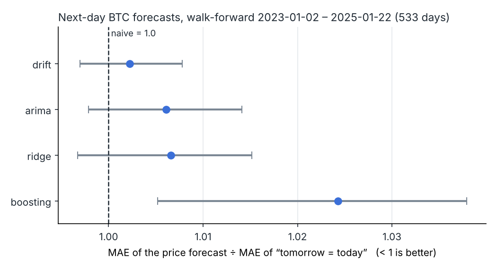
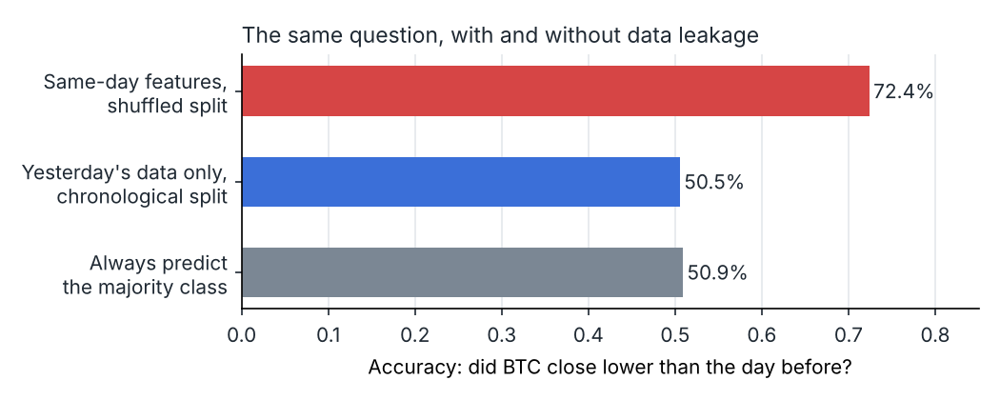
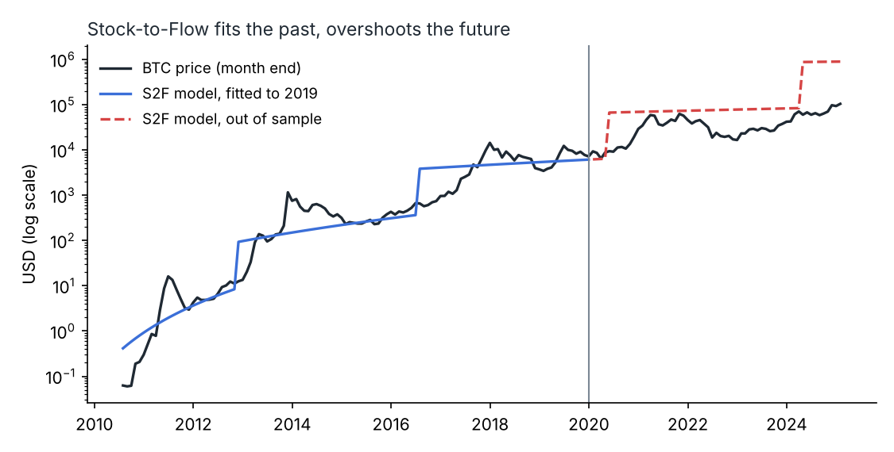

# btc-forecast-eval

**Can you forecast Bitcoin?** Five forecasters — from "tomorrow = today" to ARIMA, linear models and gradient boosting (LSTM optional) — compared on two years of daily BTC/USD with walk-forward evaluation. Plus the three mistakes that make Bitcoin forecasts in tutorials look accurate, each measured next to its honest version.

🇵🇱 *Czy da się przewidzieć kurs bitcoina? Uczciwe porównanie modeli na danych dziennych z testem kroczącym oraz trzy błędy, przez które prognozy z tutoriali wyglądają na trafne.*


**Key results** (test period 2023-01-02 – 2025-01-22, 533 trading days)

- **No model beats the naive forecast** ("tomorrow's price = today's"). The best, drift, is 0.2% worse on MAE; boosting is 2.4% worse, and that difference is significant.
- **Direction is a coin flip:** 49.5–51.2% of days called correctly, vs 51.2% for "always up".
- **The same data with a leaky setup gives 72% accuracy;** the honest version 50.5%.
- **Stock-to-Flow** fitted to 2019 (R² 0.91) predicted ~$895k for January 2025; the price was $104k.

> Not investment advice. This project is about evaluation methodology.

## Why this project

I first built it during the AI Engineering course at SDA (2024–2025). Reviewing it later, I found that the course version reported numbers that did not mean what they seemed to: a model fed today's price to "predict" today's price, R² on price levels, a Stock-to-Flow chart drawn on US-dollar-index values instead of BTC, and an LSTM chart with typed-in example numbers. This repository is the rebuild: the same model families, evaluated so that a result can be trusted — and the old mistakes kept as a measured lesson.

## Results

### 1. Next-day forecasts, walk-forward

Each model is refitted every 21 trading days on all data since 2014 that precedes the forecast day, and predicts the next day's log return; the price forecast is the last close × exp(predicted return). Nothing from the forecast day or later is ever used.



| Model | MAE (USD) | MAE vs naive | 95% CI (block bootstrap) | Diebold–Mariano p | Direction hit | Long/flat, before costs |
|---|---:|---:|---:|---:|---:|---:|
| naive (tomorrow = today) | 1137 | 1.000 | — | — | — | — |
| drift (mean past return) | 1140 | 1.002 | 0.997–1.008 | 0.06 | 51.2% | +529% |
| ARIMA(1,0,1) on returns | 1144 | 1.006 | 0.998–1.014 | 0.28 | 49.5% | +399% |
| ridge on lagged returns | 1145 | 1.007 | 0.997–1.015 | 0.64 | 49.7% | +303% |
| gradient boosting | 1165 | 1.024 | 1.005–1.038 | 1.00 | 49.9% | +302% |

"Always up" hits 51.2% of days; buy & hold returned +529%. Drift is always positive in a bull market, so its long/flat rule *is* buy & hold. Every model that tries to time the market does worse than holding, even before trading costs. The Diebold–Mariano test (squared return errors vs naive) finds no model significantly better at 5%.

This is what an efficient, near-random-walk market looks like. A forecast that beats "tomorrow = today" by a large margin on daily data almost always has a leak.

### 2. Three ways to fool yourself



| Mistake (from the course version) | Leaky result | Honest check |
|---|---|---|
| Predict "did BTC close lower than yesterday?" from today's open/high/low/close, shuffled split | **72.4%** accuracy | Yesterday's data, chronological split: 50.5%; majority class 50.9% |
| Regress price on yesterday's price, report R² | **R² 0.998** | Naive "tomorrow = today": R² 0.998, and smaller error ($458 vs $463 MAE) |
| ARIMA(5,1,0) on prices, one 573-day forecast, report RMSE | RMSE $35,541 | Forecast is a flat line ($20,136–$20,181) = "last price forever", RMSE $35,531 |

### 3. Stock-to-Flow, out of sample



S2F = coins in circulation ÷ coins issued per year, from the real issuance schedule (supply at the four halvings 10.5M, 15.75M, 18.375M, 19.6875M BTC). log(price) = −2.49 + 3.38 · log(S2F), fitted on monthly prices to December 2019: **R² 0.91**. On the 61 months after, actual price was a median **0.36×** of the model (range 0.07–1.50×); in January 2025 the model said **$894,665**, the market **$104,357**. S2F is a step function of time; a good in-sample fit says little about the future.

## Run it

```bash
git clone https://github.com/Volers321/btc-forecast-eval && cd btc-forecast-eval
python3 -m venv .venv && source .venv/bin/activate
pip install -e ".[dev]"
btcfe download          # BTC/USD daily from stooq.pl -> data/btcusd_d.csv
btcfe all               # eval + leakage + s2f; tables in the terminal, JSON in results/, charts in docs/
pytest -q
```

Options: `btcfe eval --test-from 2024-01-01 --refit 5`, `--models drift,arima,ridge,boosting,lstm` (LSTM needs `pip install -e ".[lstm]"`).

## Data

Daily BTC/USD from [stooq.pl](https://stooq.pl/q/d/?s=btcusd) (`Data, Otwarcie, Najwyzszy, Najnizszy, Zamkniecie`). Two things to know:

- stooq lists **weekdays only** (~259 rows a year), although Bitcoin trades every day. A Monday return spans the weekend. Forecasts here are "next listed day".
- The price file is not redistributed in this repository; `btcfe download` fetches it.

The results above use the file I downloaded on 2025-01-22. A fresh download extends the test period.

## Design notes

- `evaluate.walk_forward` is the only place that touches the test period; a test asserts that the prediction for day *t* sees exactly the returns before *t*.
- Scalers live inside scikit-learn pipelines, so they are fitted on training data only. The course LSTM fitted its scaler on the whole series.
- The MAE ratio uses a moving-block bootstrap, because errors on consecutive days are correlated.
- Tests on a synthetic random walk check that no model "beats" an unpredictable series and that the leakage demos reproduce their effect.

## License

MIT
